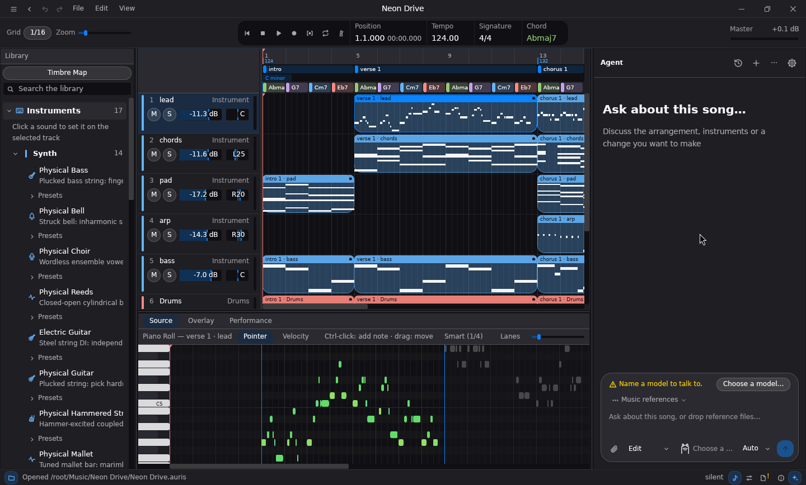
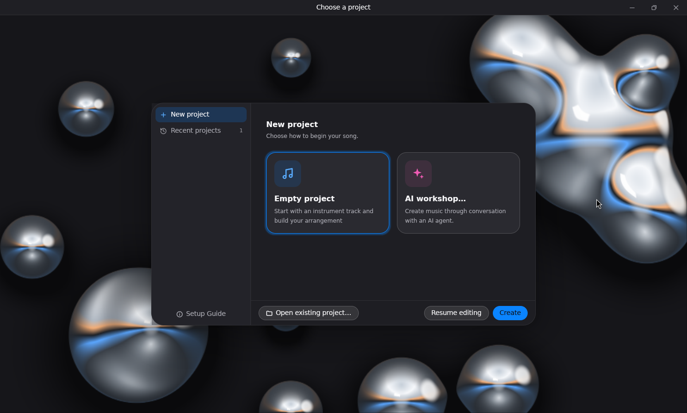
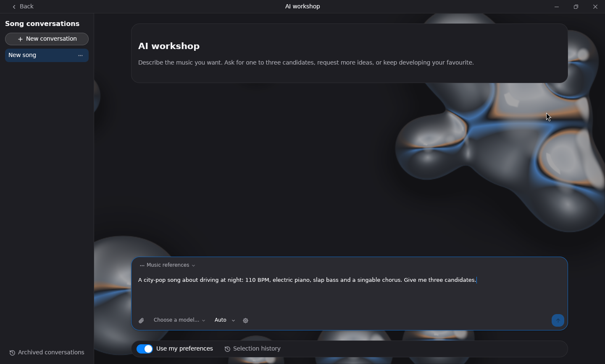

[日本語](README.ja.md)

# Auris Studio

A digital audio workstation written in Rust with a GPU-rendered
[gpui](https://crates.io/crates/gpui) interface for macOS and Windows. Arrange and edit
music, compose from text specifications, record audio, host CLAP and VST3 plugins,
and render singing voices. CLI, MCP and agent frontends share the desktop's editing commands.



| Start a project | Compose with the AI workshop |
| --- | --- |
|  |  |

## Install

Download the Windows installer or macOS disk image from the
[releases page](https://github.com/uthree/auris-studio/releases). The desktop, `auris` CLI and
`auris-mcp` ship together. Linux has a CLI archive. See [Installation](docs/installation.md)
for portable downloads and command-line paths. Built-in physical instruments are ready to play.

To build from source with Rust 1.95 or newer:

```sh
git clone https://github.com/uthree/auris-studio.git
cd auris-studio
cargo run --release
```

To install the executables with `cargo install`, see
[Building and installing from source](docs/installation.md#building-and-installing-from-source).

Windows also requires Visual Studio C++ Build Tools and LLVM. Run
`.\tools\setup-windows.ps1 -InstallLlvm` in a Visual Studio developer PowerShell terminal
before building. See [Development](docs/development.md#building-on-each-platform) for
platform setup. See [physical instruments](docs/physical-instruments.md) for the native sounds.

## Install the composition agent skill

The optional `auris-composition` skill helps a coding agent use Auris Studio to compose,
render, and check original music. Install it for Codex with:

```sh
npx skills add uthree/auris-studio --skill auris-composition -a codex -g -y
```

This installs the skill globally. To install it only in the current project, run the
command from that project's directory without `-g`. The skill does not install the
Auris Studio application or its CLI; install those separately using the steps above.
See [Agent skills](docs/agent-skills.md) for updates, paths, and MCP configuration.

## Documentation

- [Features and usage](docs/features.md)
- [Automatic composition](docs/composition.md)
- [Agent and MCP workflows](docs/agent-workflows.md)
- [Installation and portable releases](docs/installation.md)
- [Installing the Auris composition agent skill](docs/agent-skills.md)
- [Singing backends](docs/singing-backends.md)
- [Development](docs/development.md) and [composition evaluation](docs/evaluation.md)
- [Changelog and compatibility policy](CHANGELOG.md)

Licensed under [Apache-2.0](LICENSE).
