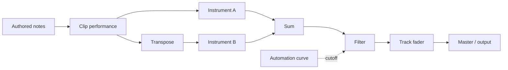

> [!WARNING]
> **This branch is deprecated and will not be merged.** `codex/render-pipeline-design`
> (typed render pipeline, native format 33) was shelved on 2026-10-30. Its idea is being
> rebuilt in a smaller, format-compatible form on `main` ("layers": instrument tracks that
> follow another track's notes, uthree/auris-studio#55). Do not base new work on this branch
> and do not open files it saved with `main` builds: its format 33 is a different format from
> `main`'s format 33. The branch is kept for reference only, and the tag
> `archive/render-pipeline-design` marks its final state.

# Typed rendering pipeline

Status: proposed design, 2026-10-27. No pipeline behavior is implemented by this
document. The inspected baseline is commit `cd205c3c`, project format 32.
Names and request examples below specify proposed contracts, not available APIs.

The system account remains `auris_session::guide`. Update that account with each
implemented boundary change. See [the delivery plan](render-pipeline-plan.md) for
dependencies, acceptance criteria, migration fixtures and release gates.

## 1. Product outcome

A user can edit one musical source, perform it through different non-destructive
arrangements and instruments, automate their controls, and combine the results.
Timeline, processing-chain, mixer-console and graph views edit the same document.
Agents use musical commands for common changes and typed graph edits for unusual
connections. They share the UI's validation, history and execution semantics.

The first complete workflow is one note clip feeding two independent instruments,
with a transpose on only the second branch, both feeding a shared filter whose
cutoff follows an automation curve. Source edits propagate to both branches;
branch settings survive. Undo, save/reload, playback and export preserve this result.



## 2. Baseline and architectural decisions

| Current owner | Existing contract | Extension |
| --- | --- | --- |
| `auris-core::Project` | Tracks own clips, one instrument or singer, strips and routes | Separate authored sources, processing nodes and presentation groups |
| `MidiClip` | Ordered non-destructive transforms; seeded performance; authored curves | Preserve clip semantics and expose stable stage identities |
| `Project::automation` | One curve per `ParamTarget` | Independent curve identity and typed node/stage bindings |
| `Session::mixer_graph` | Projection of strips/inserts; stable IDs; validated edits | Typed pipeline projection, then canonical processing topology |
| `auris-engine::RenderGraph` | Prepared off the callback; shared playback/export renderer | Compile typed topology into bounded execution plans |
| Singer planning/render/landing | Offline generation, saved take, dependency fingerprint | Per-singer-node jobs and downstream invalidation |
| `Session` history | Whole-project snapshots, grouped transactions | Atomic graph edits and shared-source ownership rules |

Decisions:

1. Ports carry musical events, audio or control values. Validate connections before
   changing the live document.
2. Persist one authoritative owner for each value and connection. Views and runtime
   plans are projections; neither becomes a second editable store.
3. Separate preparation dependencies from realtime scheduling. A singer and a filter
   may appear in the same editor without sharing an execution rate.
4. Preserve authored notes, lyrics, recipes, seeds, assets and existing performance
   semantics during migration. Regeneration remains an explicit command.
5. Keep common workflows accessible through ordinary timeline and chain controls.
6. Retain downhill crate dependencies and main-thread ownership of hosted plugins.

## 3. Document model and identity

### 3.1 Ownership

The target `Project` contains these conceptual collections. Exact Rust definitions
will be reviewed in milestone M2 before a new file format is enabled.

| Collection | Authoritative contents |
| --- | --- |
| Timeline tracks | Existing `TrackId`, name, color, order, lane height, source reference and home processing group |
| Sources | `SourceDocumentId`, authored MIDI/singer/audio clips, recipes and clip-local performance stages |
| Pipeline nodes | `NodeId`, typed processor settings, plugin/singer state, source or automation references |
| Pipeline edges | `EdgeId`, source port, destination port and connection role |
| Automation curves | `AutomationId`, points, interpolation and time domain |
| Processing groups | `GroupId`, membership, exposed ports, console strip and primary instrument selection |
| Assets | Existing audio-source and SoundFont registries and `AssetPath` references |
| View state | Stable node/group positions, collapsed state and viewport; no processing semantics |

`SourceDocumentId` is distinct from the existing `SourceId` for audio assets.
A source node references a source document; it does not copy its clips. Each
instrument node owns its own plugin state and runtime instance. Multiple outgoing
edges from one instrument share its rendered output; two instrument nodes produce
independent performances and state even if they use the same preset.

A group owns organization and exposed controls, not a hidden second routing chain.
Its chain view derives order from graph edges. When a path branches, the chain
shows an explicit branch container instead of inventing a serial order.

Keep clip-local stages inside their clip: they use clip-local time and apply before
that clip enters its source output. Add stable `StageId`s to their ordered entries.
The graph expands these as a derived internal subgraph. Reordering uses the clip
stage command; internal wires are not separately saved or freely reconnectable.
Branch transforms are real pipeline nodes operating on the source's timeline output.
This preserves clip scope without storing every loop instance as a node.

### 3.2 Stable references

Use typed IDs internally and tagged references on the wire, for example
`node:120`, `edge:121`, `source:122`, `automation:123` and `clip:8/stage:124`.
Never identify processors by label, vector index or canvas coordinate. Allocate
new IDs through the document's checked allocator and include all new collections
in duplicate-ID checks and counter repair. Preserve existing track, clip, effect,
send and audio-source IDs through migration.

Retain `EffectSlotId` as the stable identity of a migrated plugin instance, referenced
by its processor node. The old slot no longer independently owns parameters or chain
order. Existing `effect:N` references resolve to that node. `track:N` resolves to
its console strip for mixer operations and to its source for score operations;
the command schema determines the role. It must never guess an arbitrary instrument
when a group contains several. Persist the group's primary instrument for compatible
track-scoped instrument commands and allow explicit node selection.

Removing a group removes its owned processors, bindings and incident edges in one
transaction. It does not remove a source still referenced by another group or timeline
track. Removing a shared source requires an explicit detach/delete choice and a list
of affected consumers. Duplicating a branch shares its source and copies processor
state with new IDs; duplicating a source makes independent clips with new IDs and
retains their saved seeds. These are different named commands.

### 3.3 Node and port contracts

| Node kind | Input | Output | Evaluation |
| --- | --- | --- | --- |
| Note source | Source reference | Musical events | Preparation / bounded live input |
| Note transform | Musical events | Musical events | Preparation initially |
| Instrument | Musical events, parameter controls | Stereo audio | Realtime |
| Audio source | Asset/clip references | Stereo audio | Prepared decoding, realtime playback |
| Singer | Musical events with lyrics, voice settings | Cached stereo audio | Background generation, realtime playback |
| Audio sum | Explicit audio inputs | Stereo audio | Realtime |
| Effect | Audio, optional sidechain, parameter controls | Stereo audio | Realtime |
| Strip | Audio, gain/pan controls | Pre/post-fader audio | Realtime |
| Automation source | Curve reference | Control values | Consumer-dependent |
| Control mapping | Control values | Scaled/clamped control | Consumer-dependent |
| Master/output | Audio | Device/export boundary | Realtime / offline renderer |

Musical events preserve lyrics, authored-note provenance, channel/controller data,
articulation and source identity; raw MIDI alone is insufficient. Performed events
carry origin clip/note and branch identity so selection, chase and release do not
confuse equal pitches from different sources. Phrase transforms preserve or explicitly
derive provenance for inserted notes. Shared upstream humanization is evaluated once
per source/pass; branch-local stages have their own stored seeds.

Audio is stereo at the first delivery, matching `RENDER_CHANNELS`. Port descriptors
still declare layout and reject mismatches. Audio fan-in happens only at declared
summing inputs. Musical-event fan-in requires an explicit merge contract, including
controller conflicts and note identity; single-input musical processors reject a second
input. A sidechain port is audio with a distinct role, not a parameter connection.

For a conventional track, the explicit path is source, instrument, inserts, strip,
destinations. For a bus/master it is sum, inserts, strip, destinations/output.
The strip's pre-fader port is after inserts and before gain/pan, preserving current
send semantics. A send keeps its stable `SendId`, level and tap; represent its gain
as an addressable send processor so automation never targets an anonymous wire.
Empty outputs remain disconnected. Grouping cannot add a master connection implicitly.

### 3.4 Automation and parameter semantics

A parameter descriptor includes a stable plugin key or built-in key, value domain,
unit, range, step, default, mutability and evaluation policy. Resolve plugin keys to
runtime indices during compilation. Preserve the current normalized VST3 domain;
an Hz label does not make a normalized control accept Hz values.

Store curve points once in `AutomationId`. A binding edge targets
`(NodeId, ParameterKey)` or a stable clip stage parameter. One curve can feed multiple
compatible bindings; each differently scaled destination uses an explicit mapping
node. Initially a target accepts one absolute driver. Its static value remains
stored and becomes effective when that binding is disabled or removed. Conflicting
drivers are rejected, with the existing binding returned in the error.

| Evaluation policy | Examples | Contract |
| --- | --- | --- |
| Realtime continuous | Gain, pan, compatible effect controls | Segment-rate values and existing ramps; finer timing only when supported |
| Event sampled | A later automatable transpose stage | Sample at the authored event start; pair its release with the resulting pitch |
| Preparation only | Phrase-aware strum/humanization settings | Recompute affected prepared events before publishing |
| Regeneration required | Singer voice / synthesis settings | Invalidate the take; do not run inference in the callback |
| Structural | Node type, channel layout, connections | Transaction and recompile; not a scalar automation target |

MVP branch transforms are static preparation operations. Do not advertise arbitrary
transform automation until each parameter has a defined event/phrase sampling rule.
Later additive/modulation controls use explicit combiners with defined order, range
clamping and units, rather than several writes racing on one parameter.

Preserve existing curve behavior: no lane means use the static value; an existing
lane holds its nearest endpoint outside its point range. Migrated project automation
uses absolute project ticks. Clip stage envelopes, when enabled later, declare
clip-local ticks and loop behavior explicitly. Moving a clip cannot silently move
project automation. Arrangement commands that move both do so explicitly.

## 4. Compilation, time and background work

The document compiler validates references, typed ports, resource bounds and all
immediate audio/event/control/sidechain dependencies before topological ordering.
Report the actual cycle path. Do not validate three edge families independently:
an audio-to-control dependency can close a mixed cycle.

Compilation produces:

1. A preparation plan for phrase evaluation, lookahead, clip expansion and jobs.
2. A realtime plan with flat node order, resolved parameters, preallocated event and
   audio buffers, sidechain taps, delay compensation and observation taps.

The engine consumes prepared musical events, assets and core plugin traits. Singer
orchestration stays in the session; the engine does not acquire a singer dependency.
Hosted plugin main-thread halves stay with session hosts, keyed by instance identity.
Runtime instrument placement must move from one-instance-per-track keys to node or
instrument-instance keys. Live audition, MIDI input, plugin editor ownership and
state capture use that same identity.

Build/allocate/destroy outside the callback. Swap a fully prepared plan at a block
boundary and retire the old plan off the audio thread. Reuse compatible plugin state
where supported; define a bounded handover for incompatible topology changes with
note release/chase and gain ramping. Never promise a seamless state transfer a plugin
cannot support. A layout change does not compile or reset an instrument.

Offline export prepares the requested document revision and fails if that plan cannot
be built; it never silently exports the previous realtime plan. The UI reports the
audible revision when playback temporarily retains an older plan. Existing-take
export policy below concerns declared singer assets, not a stale routing topology.

Use project ticks for musical placement, the tempo map for sample positions, and
sample offsets for execution. Earlier attacks require declared lookahead and prepared
events before their deadline. Initial transforms evaluate the bounded clip/phrase,
including required neighboring notes. An edit to a phrase invalidates that whole
dependency window; optimize to smaller regions only after equivalence tests exist.
Changing a tempo segment invalidates all downstream sample mappings it affects.

Seeking or looping rebuilds effective note/controller state at the destination;
automation arrives at the destination value rather than ramping from the old position.
Maintain authored sustain, pitch-bend and release timing. Align audio fan-in and
sidechain paths with plugin delay compensation, including declared lookahead.
Control timing follows the target's processing timeline. Automation that changes
plugin latency requests a new prepared plan through the existing stale-latency path.

Freeze materializes a selected boundary without altering shared upstream data.
Freezing one branch creates a private replacement source; the first-pass behavior
of clip performance freezing remains explicit. Realtime playback and offline export
consume the same evaluators and render kernel. Numerical equality tests use
deterministic built-ins; hosted stochastic instruments require bounded/timing checks.

### 4.1 Singer results and cache ownership

Each singer node has independent voice settings, last accepted take, dependency
fingerprint and generation state: missing, ready, stale, queued, rendering or failed.
Persist take identity/fingerprint and assets, not transient job state. A stale take
continues to play with visible status, preserving current behavior. Missing takes use
the existing preview policy. Export reports stale/missing nodes and requires a declared
policy (`require_current` or explicitly `use_existing`) rather than silently delivering
an obsolete result as current.

A cache key covers upstream authored/performed events and curves, relevant timing,
voice/model identity, backend/settings, seed and evaluator revision. Use a versioned
canonical digest, not a process-local hash. A deterministic key does not guarantee a
stochastic backend regenerates identical audio; saved takes preserve the performance.

Capture immutable input, node identity and dependency digest; generate under a
bounded concurrency gate; stage assets; revalidate before landing. A changed source,
deleted node, Undo or cancelled job prevents stale completion from replacing the
current take. Unrelated mixer/layout changes need not reject a still-valid result.
The landing decision and document update happen with session ownership, without a
time-of-check/time-of-use gap. An async job never holds an Undo transaction open.

Changing an effect after the singer invalidates only downstream execution, not its
take. Changing a shared source invalidates every consuming singer. Saved takes and
history references are durable assets; disposable preparation caches are separate.
Garbage collection must respect open jobs, Undo snapshots and checkpoints.

## 5. File-format migration and recovery

### 5.1 Rollout boundary

M1 is a projection over the current document. It does not introduce a second persisted
graph. M2 introduces a versioned new representation and one-way legacy conversion.
The baseline reader supports formats 27 through 32. Preserve that set and add versions
introduced before this work merges. Reserve no hard-coded next version in this plan:
bump `Project::FORMAT_VERSION` from its actual value when the new schema ships.

A version bump is mandatory even if a new field could have a serde default: an older
application must refuse a graph it would otherwise ignore and play incorrectly.
Read the version before parsing. Dispatch legacy versions into dedicated legacy
representations and convert them to the one current in-memory model. Apply existing
aliases/defaults/repairs before topology conversion. A current-version file must contain
its required topology; missing graph data is not treated as an empty default graph.

### 5.2 Conversion algorithm

1. Validate legacy IDs and repair the legacy allocator as today. Preserve original
   bytes and parse without rewriting the file.
2. Visit tracks in saved order. Move their clips into source documents, preserving
   clip IDs, notes, lyrics, recipes, curves, seeds, timing and asset references.
   Wrap each existing clip transform in a stable stage entry without reevaluating it.
3. Allocate source and instrument/audio/singer nodes. Transfer plugin opaque state,
   parameters and paths exactly. Move singer voice/take/fingerprint metadata unchanged.
4. Create explicit bus/master sum nodes, insert nodes and strips. Translate serial
   insert order, outputs, sends and sidechains, preserving pre/post-fader tap position,
   send IDs, mute/solo behavior, parallel routes and deliberately empty outputs.
5. Convert each parameter target through the migration identity map. Create independent
   automation IDs, preserving points, interpolation, key realignment and value domains.
   Gain/pan targets map to strips; instrument targets to the migrated instrument;
   effect targets to retained effect identities; send targets to send processors.
6. Map old canvas positions to group anchors and effect identities. Seed new internal
   nodes by deterministic layout. Retain viewport values without changing routing.
7. Validate the converted graph and resource bounds, repair the ID high-water mark,
   and return a migration report with source/target versions and any legacy repairs.

Conversion order is deterministic for the same legacy bytes. It never instantiates
plugins or synthesizes vocals. For a graph-native round trip, IDs and references remain
unchanged. There is no ongoing synchronization with old instrument, route or automation
fields: current saves write only the new canonical representation.

### 5.3 Save, checkpoints and failures

Opening migrates in memory only. Before the first upgraded overwrite, preserve an
exact-byte backup/checkpoint of the legacy document through a no-clobber write. This
must not be a reserialized new-format snapshot labelled as a legacy backup. If that
backup fails, do not overwrite the legacy file; report the error and offer Save As.
Then use existing staged, synchronized, atomic project publication. Save As still
maintains one folder per project and portable `AssetPath::Inside` references.

Migration itself adds no musical Undo entry. Undo starts with the migrated baseline
and returns to that same topology. Legacy recovery/checkpoint files use the same loader;
restoring them does not rewrite the historical copy. Current snapshots contain graph
metadata and asset IDs, never rendered buffers. Benchmark their memory cost once
sources are shared; do not assume today's snapshot cost remains unchanged.

Preserve current legacy routing repairs and report them. Invalid native topology,
unknown required node kinds, mismatched ports or dangling semantic bindings produce
structured load/validation errors without writing the file or partially installing it.
A missing external plugin is different: retain its known node, ports, saved opaque
state and connections, expose it as unavailable, and apply an explicit silent-source
or bypass-effect policy. Do not erase it to make the graph load.

`.asong`/song specifications remain composition inputs, not substitutes for the full
project graph. Import creates conventional source/processing groups. Any conversion
to a score-only format reports unsupported graph behavior; it must not silently claim
a lossless round trip. Audit sound presets, MIDI import/export, track duplication,
freeze, stem selection and asset collection alongside the project-file migration.

## 6. UI and interaction contract

The primary task is changing how a selected musical part is performed and mixed.
The session owns musical state and commands; the frontend owns focus, selection,
layout and disclosure. All views reflect the same committed document.

| Surface | Contents and actions |
| --- | --- |
| Timeline | Authored clips, lyrics and automation lanes; shared-source indicator; select consuming branch |
| Processing chain | Selected source/group path; add/reorder/bypass stages, layer an instrument, inspect parameters |
| Signal flow | Typed ports, shared sources, branches, selected neighborhood and whole-project overview |
| Console | Exposed strip controls and sends derived from groups; selecting a strip selects its group |

Keep the current Mixer/Signal flow and Console entry points. Add source/performance
expansion within Signal flow and a selected-group chain inspector before considering
another top-level workspace. Show a collapsed group by default, with an explicit
branch summary. Collapsing never changes processing. A shared source displays its
consumer count and a command to reveal consumers; editing shows its actual scope.

Use separate ports/labels for events, audio, control and sidechain. Color supplements
port names and line patterns. Show the absolute automation binding at its parameter;
expand control wires on selection or with a persistent visibility option. Selecting a
wire identifies its stable edge and exact endpoints. Selection, keyboard focus and
hover have distinct states. A disabled connection explains type/range/cycle mismatch.

Key workflows:

1. **Layer instrument:** select a part, invoke the chain command, choose an instrument,
   and create a second branch plus sum before the existing group inserts in one Undo
   step. Both branches initially have unity gain; show the resulting meters and expose
   branch levels. Do not silently normalize the mix.
2. **Transform one branch:** select its chain, add Transpose, set semitones, and compare
   authored/derived note previews. This edits only that branch.
3. **Automate a parameter:** use its menu, create/select a lane and draw points on the
   timeline. The graph shows its binding without requiring manual control wiring.
4. **Rewire:** select source port, invoke Connect, filter compatible destinations,
   choose one and commit. Dragging is an equivalent shortcut. Escape cancels the
   unfinished gesture and restores focus. Delete removes exactly the selected edges.
5. **Inspect a singer:** show existing take age/state, affected inputs, render/cancel,
   failure detail and retry. Do not display stale audio as newly generated.

The inspector shows intermediate notes, effective values versus stored static values,
audio meters and preparation status. Bypass exposes the local before/after result.
Audition must identify the tapped node and use an isolated preview path, without
rewriting project routes. Instrument audition defaults to the selected branch; group
audition addresses its declared musical entry and all intended layers.

Solo/mute retain current behavior for migrated strips. For new groups, solo follows
required upstream dependencies and downstream destinations but does not accidentally
solo sibling consumers of a shared source. Distinguish source edits from strip mute.

Layout uses theme tokens and rem-based geometry. The inspector is resizable/dismissible;
its controls scroll locally when narrow, leaving the primary editor usable. Persist
layout by stable identities and preserve current layout Undo/camera behavior. Auto-layout
does not change execution order. Keyboard menus expose every essential graph operation.
Use `secondary-` shortcuts, visible focus, localized labels and accessible names.

Design QA covers empty graphs, disconnected sources, missing plugins, invalid edits,
pending/failed preparation, stale takes, readonly state, large graphs, long Japanese
labels, light/dark themes, interface zoom and minimum window size. Measure actual
geometry in a real window; use the headless harness for behavior, not pixel assertions.

## 7. Agent tools and transaction protocol

### 7.1 Two levels of operation

High-level operations express musical intent and expand to the same validated edit
plan as the UI. Extend relevant existing performance/automation/singer commands where
possible rather than publishing a separate tool for every node type.

| Proposed operation | Required scope | Result |
| --- | --- | --- |
| `layer_instrument` | Source/group and exact discovered instrument ID | Branch, optional branch level and sum wiring |
| `set_branch_performance` | Branch and typed stage settings | Non-destructive ordered stages |
| `bind_automation` | Stable target/key and curve/domain | Curve plus binding or explicit replacement |
| `add_singer_layer` | Source/group and discovered voice identity | Independent singer node; generation is a separate action |
| `freeze_branch` | Boundary and range/pass policy | Private rendered source; other consumers preserved |

Detailed operations are divided into small typed contracts:

- `pipeline_read`: overview, neighborhood or path; filters by domain/group; paged
  stable nodes/edges and revision. Return boundary references for edges outside the page.
- `pipeline_describe`: a node type, port or parameter; capabilities, units, allowed
  operations, limits and evaluation policy. Plugin parameters remain paginated.
- `pipeline_edit`: tagged operations with `validate` or `apply` mode; bounded batch
  of create/connect/disconnect/set/reorder/remove operations and explicit references.
- `pipeline_job`: start/status/cancel for background work; durable result identity and
  currentness. Reuse the existing detached-job ownership pattern.

Descriptions are discovered on demand. A single free-form JSON field or a single huge
all-node schema is not the simplification goal. Use tagged schemas with unknown-field
rejection and domain-specific bounded payloads. The existing `mixer_graph` remains a
compatibility facade for strip/effect/send operations; it calls the same session layer.
Return a typed unsupported-scope error for a topology that an old operation cannot
express, rather than flattening or deleting connections.

### 7.2 Example and edit guarantees

Illustrative high-level request, with IDs and revisions obtained from discovery:

```json
{
  "mode": "apply",
  "expected_revision": "opaque-document-revision",
  "request_id": "client-unique-operation-id",
  "operations": [{
    "kind": "layer_instrument",
    "source": "source:122",
    "group": "group:110",
    "instrument": "discovered.instrument.id",
    "performance": [{"kind": "transpose", "semitones": 12}]
  }]
}
```

Detailed batches may create nodes using request-local aliases such as `$layer`, then
connect those aliases. Resolve them to stable IDs only on successful commit; report
the mapping. Do not make the agent predict allocator values.

Use the existing opaque content revision contract for saved and live document edits,
not an unrelated session counter that resets when MCP reopens a file. Define its
semantic inputs explicitly; camera navigation does not invalidate a musical edit.
Validate paginated reads against one revision, returning a stale-page error if the
document changes between pages.

For every apply:

1. Resolve request identity, revision, IDs, capabilities and permissions. Refuse to
   join or close a human gesture transaction.
2. Apply the batch to a candidate document, validate the final topology and resource
   bounds, and compute affected consumers/jobs. Intermediate candidate states need
   not be playable, but must never reach the live renderer.
3. Recheck revision and commit one document/history change. Publish runtime changes
   through preparation; failed preparation retains the previous valid audible plan
   with an explicit pending/failed state and retry/undo actions. A bad edit never
   becomes a partly applied document.
4. Saved execution stages and publishes one checkpointed save; live execution is
   undoable and unsaved. Report persistence and audible-plan status separately.

Saved execution must also revalidate the opened file's identity/fingerprint before
publication under the project's writer coordination mechanism. An in-memory revision
check alone cannot detect another process changing the file after MCP opened it.
Serialize cooperating writers and return a conflict if the destination changed; do
not promise protection from arbitrary uncoordinated filesystem writers. A failed save
returns `saved:false` and does not claim a durable receipt. Live save failures retain
the visible unsaved edit for retry; saved-only execution leaves the prior file intact.

`validate` returns a concrete diff and predicted invalidation with no document edit,
save, job launch or lasting ID allocation. It is optional for normal edits and is not
a new mandatory confirmation step. Apply always revalidates. Preserve the current
permission policy for reads, edits, removals, plugin access and synthesis resources;
the strongest operation in a batch determines its permission class.

Return `changed`, previous/current revision, allocated IDs, changed objects,
affected consumers, invalidated takes, diagnostics, history reference, `saved` and
runtime state. No-ops add no Undo/checkpoint. Errors carry a code, operation index,
object references and a recovery action (`revision_conflict`, `cycle`, `port_mismatch`,
`parameter_domain`, `shared_source_in_use`, `resource_limit`, `gesture_open`).

Persist a bounded request receipt with successful saved edits so a lost MCP response
can be retried after reopening without creating another branch. Bind receipts to a
canonical payload digest and document identity; ID reuse with different content is an
error. A retry of an already committed request returns its receipt before checking
the old expected revision, while also reporting the current revision. Live receipts
stay with the session. Undo does not turn a retry into a new creation; replay after
Undo requires a new request ID. Expired receipts fall back to revision checks and
cannot promise exactly-once execution indefinitely. Define this protocol before
advertising retry safety in the tool description.

Store saved receipts in a bounded document metadata ledger so the edit and receipt
publish atomically. Exclude it from musical digests. On Undo/Redo, retain the current
ledger rather than restoring an older ledger from the project snapshot; otherwise a
lost-response retry could recreate an undone branch. Save As creates a new execution
document identity and clears its receipt ledger. Checkpoint restoration starts a new
execution epoch. History remains responsible for musical content, not request replay.

## 8. Crate ownership

| Crate | Responsibility |
| --- | --- |
| `auris-core` | Serializable sources/nodes/ports/IDs, topology validation, pure musical transforms and parameter contracts |
| `auris-io` | Version probe, legacy decoding/conversion, durable backup, atomic persistence and asset references |
| `auris-session` | Commands, candidate validation, history, dependency invalidation, jobs, plugin ownership, compatibility adapters |
| `auris-engine` | Compiled realtime plan, event scheduling/chase, audio routing, delay compensation and meters through core traits |
| `auris-singer` | Existing voice synthesis backends and capabilities; no UI or graph editing |
| `auris-toolbox` | Shared English model schemas, discovery and reports over session commands |
| `auris-agent`, `auris-mcp` | Transport, cancellation and permission integration; no parallel graph implementation |
| `auris-gpui`, `auris-i18n` | Views, interaction, geometry and localized human-facing vocabulary |

## 9. Decisions to validate before widening scope

Measure snapshot memory, preparation latency, graph-swap continuity and tool-call/error
counts on the first layered-instrument workflow. Expand to singer branches only after
the ownership and migration gates pass. Event-sampled transform automation needs
explicit phrase semantics and prototype evidence; control combiners and reusable
groups need a usability check with both chain and graph views.

The implementation plan must record results and any changed decisions. Performance
claims require measurements, and audio quality claims require their stated evidence;
graph correctness or a nonzero waveform alone does not establish musical improvement.
