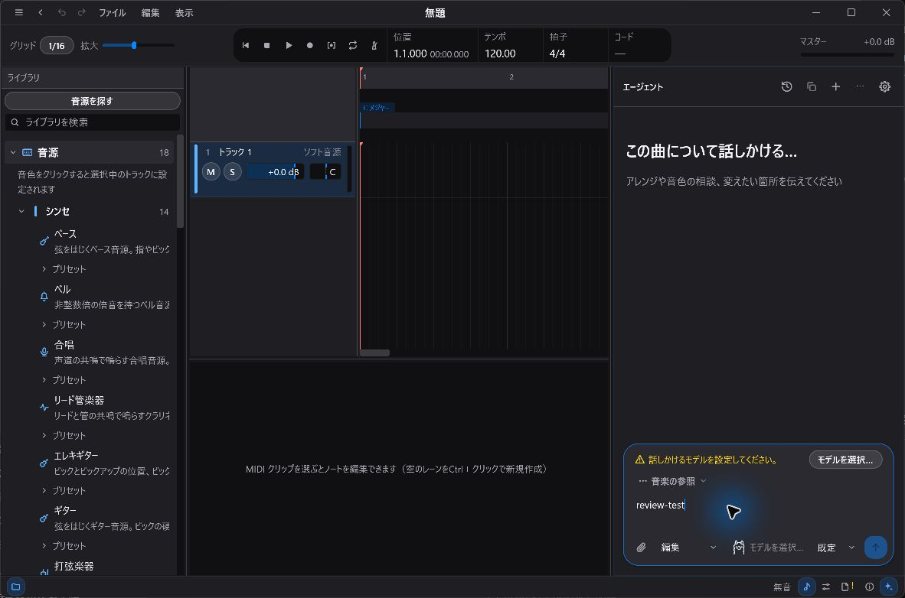
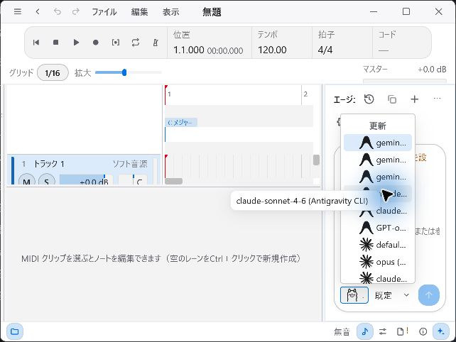
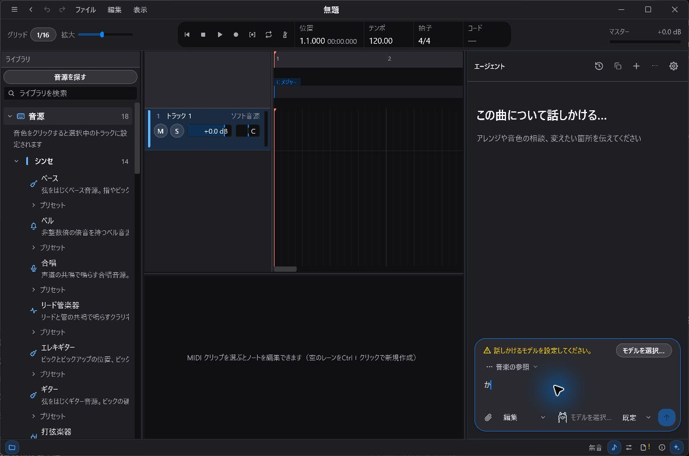
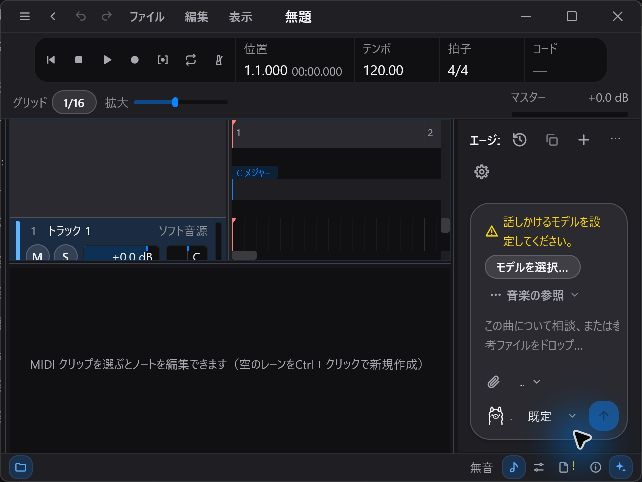

# Windows review — 2026-11-04

Reviewed baseline: `3874085f602a28035f38b455b5af07ee09307fd1`.
Native environment: Windows 11 Home, build 26300; Japanese UI and Microsoft IME.
Toolchain: Rust 1.99.0. The desktop used a temporary configuration directory and
disposable projects; native input checks used the accompanying Undo fix.

## Scope

The review combined workspace tests, source inspection, native desktop checks,
and a real Surge XT CLAP comparison against PR #151. Source inspection covered
session commands, project and asset persistence, plugin graph ownership, agent
and workshop cancellation/persistence, text input, and narrow-window layout.
This is a bounded review, not an assertion that every code path or open PR was tested.

## Findings and follow-up

### Text fields did not support local Undo/Redo

`TextField::apply_key` ignored Ctrl+Z and Ctrl+Shift+Z. A regression test failed
on the baseline because the shortcut returned `Ignored` instead of restoring
the prior text. The accompanying fix adds bounded local history, preserves
Unicode selections, groups IME composition updates, and clears native pre-edit
state when restoring a snapshot. Replacing a field starts fresh history.

The Agent composer harness checks that Undo/Redo changes its text without
changing the session revision. Native Windows checks confirmed that typing
`review-test`, Undo, and Redo clears and restores the draft. Microsoft IME input
of `か`, committed with Enter, could also be undone.



### Extreme finite sample rates panic in Reverb preparation

Reported as [#155](https://github.com/uthree/auris-studio/issues/155).
The CLI accepts `auris new ... --sample-rate 1e300`. Adding an enabled
`auris.fx.reverb` to the saved master effect chain and rendering exits with
code 101 at `crates/auris-dsp/src/reverb.rs:310` (`attempt to add with overflow`).
The sample rate reaches the delay-length calculation as an infinite `f32`.
No release-build allocation stress was attempted. Ordinary sample rates are
not implicated by this reproduction.

### Model names become indistinguishable in a narrow Agent panel

Reported as [#156](https://github.com/uthree/auris-studio/issues/156).
At the supported 640×480 window size, the 180 px Agent dock leaves roughly
105 px for its model picker. The popup inherits that width, so several entries
are rendered as `gemin...` or `claude...`. Each full value is available on hover,
but choosing between models requires inspecting individual tooltips.

The relevant path is `agent_model_picker` / `model_option_rows` /
`agent_dropdown_popup` in `ui/agent_chat.rs`, with `bounded_picker_label` in
`ui/widgets.rs`. Existing bounds tests require the popup to remain inside the
panel; they do not test whether model names can be distinguished. A wider popup
bounded by the viewport would keep the compact trigger while exposing choices.



### Intermittent existing persistence assertions

Reported as [#157](https://github.com/uthree/auris-studio/issues/157).
Two different full-suite runs exposed failures in existing GPUI tests:

- `settings_window::personalization::tests::preference_history_can_be_corrected_removed_and_reset`:
  `preferences.selections.is_empty()` failed at line 522. An isolated rerun and
  twenty subsequent exact runs passed.
- `ui::timbre_map::tests::manual_categories_survive_ai_and_rescans_and_can_be_reset`:
  the saved `sound_icons` still contained the reset key at line 1931.

The harness uses one process-wide configuration directory. Some tests also
restore complete settings snapshots, making shared persistence an investigation
target. These observations do not establish the precise interleaving or a
production data-loss bug. No unrelated persistence implementation was changed.

## Existing issues and pull requests

### Surge XT: #147 and #151

Results were posted to [issue #147](https://github.com/uthree/auris-studio/issues/147#issuecomment-6611923521)
and [PR #151](https://github.com/uthree/auris-studio/pull/151#issuecomment-6611922495).
PR head tested: `5a5cb7f9964ef69f0d673c529f57a3e7bf293801`.
Plugin: installed Windows Surge XT CLAP 1.3.4.

The [probe](repro/2026-11-04-surge.rs) creates four hosted tracks, adds twelve
MIDI clips without polling, adds one note, and renders. To repeat, copy it to
`crates/auris-session/examples/review_surge_stress.rs`, then run:

```powershell
cargo run -p auris-session --example review_surge_stress --locked -- "C:\Program Files\Common Files\CLAP\Surge Synth Team\Surge XT.clap"
```

| Measurement | Baseline | PR #151 |
| --- | --- | --- |
| `add_midi_clip`, 12 edits | 1,242–6,520 ms each | 0.465–2.986 ms each |
| Observed process peak working set | 1,600,249,856 bytes | 117,829,632 bytes in a repeat run |
| Offline render | 288,000 frames; finite; peak 0.212545 | 288,000 frames; finite; peak 0.212073 |
| Process exit | 0 | 0 |

The repeat PR run measured 0.529–0.972 ms per edit and a finite peak of 0.212755.
Memory was sampled from the process peak-working-set counter; these are observed
runs, not controlled performance benchmarks. The synth peaks are not an audio
identity comparison. Neither baseline nor PR run reproduced the reported
segfault. Concurrent acoustic indexing and a full model-driven workshop trial
remain untested, so these results do not establish that every cause of #147 is fixed.

### Japanese IME: #2

A [native test comment](https://github.com/uthree/auris-studio/issues/2#issuecomment-6611938949)
records that Alt+backquote enabled Microsoft IME and `k`, `a` produced `か`.
The automation driver rejected the dedicated `Kanji` key, so the exact
half-width/full-width shortcut from the issue was not reproduced or ruled out.



## Native layout checks

Checked startup and editor at 1180×780, editor at the 640×480 minimum size,
Agent panel/model popup, and the settings window in Glass Dark and Glass Light.
The startup content scrolls, the minimum-size transport wraps, and settings
remain scrollable. These checks did not establish another layout defect.



## Automated validation

The full workspace run used `cargo test --workspace --locked --no-fail-fast`:
5,254 passed, 3 failed, 58 ignored. All non-GPUI targets passed. The GPUI failures
were two incorrect new test expectations and the existing timbre persistence
failure described above. After correcting the expectations and adding a
same-text IME reconversion regression, final checks were:

- `cargo test --workspace --bins --locked --no-fail-fast -- --test-threads=1`:
  1,295 passed, 0 failed, 14 ignored, including 1,272 GPUI tests. Both existing
  persistence tests passed in this serial run; their parallel flakiness remains
  open in #157.
- `cargo clippy --workspace --all-targets --locked`: passed. Cargo emitted the
  dependency future-compatibility notice for `proc-macro-error2 2.0.1`.
- `cargo fmt --all --check` and `git diff --check`: passed.

The live desktop test covered committed Japanese input, but did not exercise
every native IME reconversion/cancellation sequence. Native plugin compatibility,
long-duration playback, device hotplug, installer associations, and other open
PRs are outside the runtime coverage recorded here.
